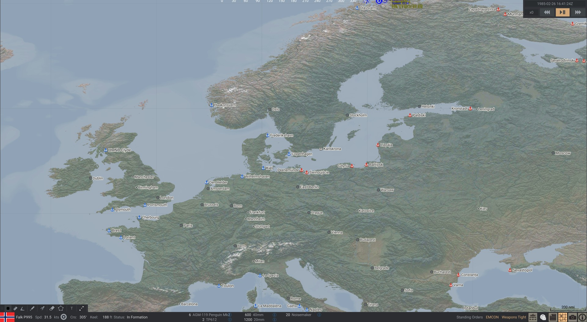

# Sea Power: R.A.T.S. Cities and Borders

Draws national borders, cities, capitals and naval bases of the mission's date on the tactical map of
[Sea Power: Naval Combat in the Missile Age](https://store.steampowered.com/app/1286220/), plus an optional coastal distance line.

| | |
| --- | --- |
| Version | `1.2.0` (2026-11-20) |
| Game | Sea Power 0.9.1 (globe build) and 0.8.7 (flat map) run in the game; declared for 0.8.7 up to every 0.9.x |
| Needs | a mod loader: [R.A.T.S. Keel](https://steamcommunity.com/sharedfiles/filedetails/?id=3835527459) or [Anchor Chain](https://steamcommunity.com/sharedfiles/filedetails/?id=3380210757), either one |
| Get it | [Steam Workshop](https://steamcommunity.com/sharedfiles/filedetails/?id=3827360064) |
| Settings | the map's Layers menu, or `BepInEx\config\dev.sewerlabs.seapowerborders.cfg` |
| Feedback | [R.A.T.S. feedback board](https://hub.sewerlabs.dev/s/borders) |
| Source | R.A.T.S. Source License, see `LICENSE` |



## Display only

- The mod only draws. It is a reference map, not the rules of your mission: missions keep their own zones and rules.
- Crossing a border or the coastal line is not a violation unless the mission says so. Follow the briefing.
- The coastal line is one reference distance from the game's coastline, the same for every country. It is not a territorial limit.
- Details and examples: [docs/features.md](docs/features.md).

## Features

- Land borders as they were on the mission's date: Soviet Union, two Germanys and West Berlin, Yugoslavia and more.
- Solid lines for borders, dashed for disputed borders, lines of control and lease limits.
- Cities, capitals, naval bases and air bases as small symbols with names; more come in as you zoom.
- Names, capitals and base years follow the date (Leningrad, East Berlin, Bonn, Holy Loch until 1992).
- Naval bases as anchors: blue for the US and its allies, red for the Soviet Union and its allies.
- Optional dashed coastal line 3, 6 or 12 nm off the coast, worked out in the game; off by default.
- Light lines and names on the map's night theme.
- Layers menu entries and keys: Shift+F7 for borders, F7 for cities and bases.
- The mission editor's map shows the same lines and labels, with two buttons at its top left.

Full detail: [docs/features.md](docs/features.md).

## Where the data comes from

- Borders and extra cities: [Natural Earth](https://www.naturalearthdata.com/), public domain; cities, ports and airfields:
  the game's own lists, read from your install. The date rules and naval bases are the author's, approximate.
- The full table: [docs/data-sources.md](docs/data-sources.md).

Made with Natural Earth. Free vector and raster map data at naturalearthdata.com.

## Install

1. Install a mod loader, either one: R.A.T.S. Keel or Anchor Chain (links above).
2. Subscribe to the mod on the Steam Workshop.
3. Tick R.A.T.S. Cities and Borders in the game's Mod Manager.
4. In a mission, turn the layers on in the map's Layers menu (Borders, Cities and bases), or press Shift+F7 and F7.

## Settings

| Setting | Default | What |
| --- | --- | --- |
| Cities: Visible, Toggle key | on, F7 | the cities and bases layer |
| Cities: Density | Normal | Fewer, Normal or More |
| Cities: Naval bases, Air bases, Civil airports | on, on, off | which places show |
| Cities: Label size | 1 | 0.7 to 1.6 |
| Borders: Visible, Toggle key | on, Shift+F7 | the borders layer |
| Borders: Era | MissionDate | or Today |
| Borders: Disputed lines | on | dashed lines |
| Borders: Line width, Opacity | 1.3, 0.85 | 0.5 to 3, 0.2 to 1 |
| Borders: Coastal distance line, nm | 0 (off) | 0, 3, 6 or 12 |

All settings: `BepInEx\config\dev.sewerlabs.seapowerborders.cfg`; the names are in the file's own comments.

## Compatibility

- Two builds in one package: `SeaPowerBorders.dll` (3D-globe game) and `SeaPowerBordersFlat.dll` (0.8.7 flat map); each stays off on the other game.
- Last run in the game: 1.1.3 on 0.9.1 (build 261112), 12 November 2026, under Keel (Red Sea Breakout).
- Editor support (1.1.0) was run on 0.8.7; the globe build was checked offline only.
- Runs under either loader. On the globe beta Anchor Chain did not start (Anchor Chain issue 19) when last checked.

## Building

- Needs the .NET SDK, a Sea Power install and the [SeaPowerKeel](https://github.com/struckl/SeaPowerKeel) repo next to this one.
- `-p:GameBuild=Flat` builds the 0.8.7 flat map DLL.

```bash
dotnet build src/SeaPowerBorders/SeaPowerBorders.csproj -c Release
```

Data tools, offline checks and the repo layout: [docs/building.md](docs/building.md). The `borders.bin` format:
[docs/borders-format.md](docs/borders-format.md).

## Credits and license

- [R.A.T.S. Source License](LICENSE): read it, fork it, send fixes; no re-uploads, no reuse in other projects.
- Natural Earth data is public domain. The game's campaign lists are read from your install, not shipped.
- Related: [R.A.T.S. Topo](https://github.com/struckl/SeaPowerTopo), [R.A.T.S. Radio](https://github.com/struckl/SeaPowerRadio),
  [R.A.T.S. Pop-Out](https://github.com/struckl/SeaPowerPopOut).
